# CAN PCB for simplified wiring

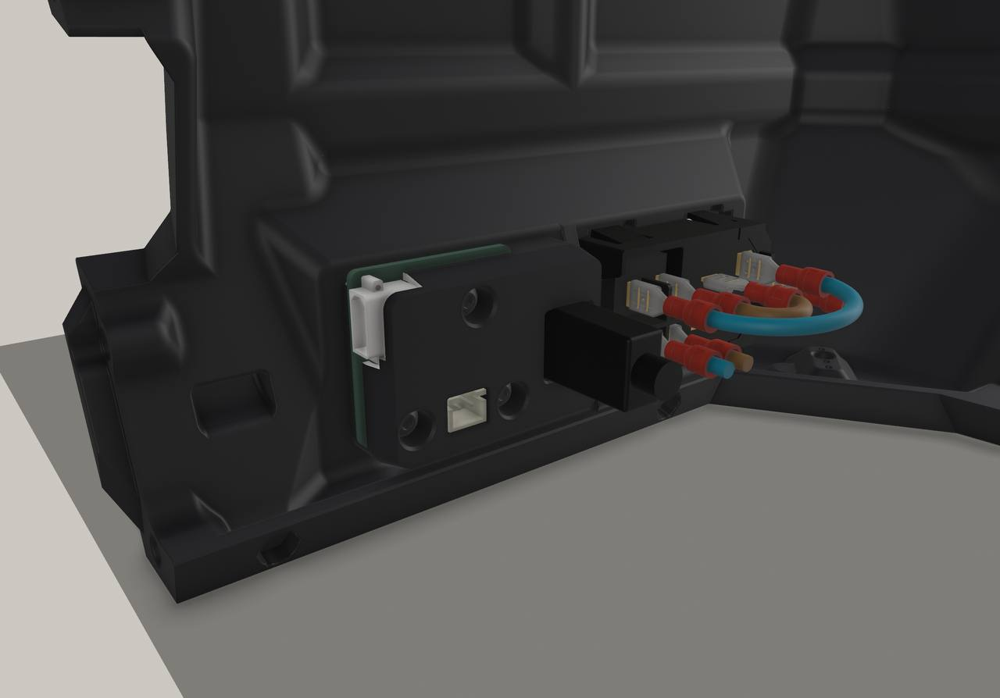
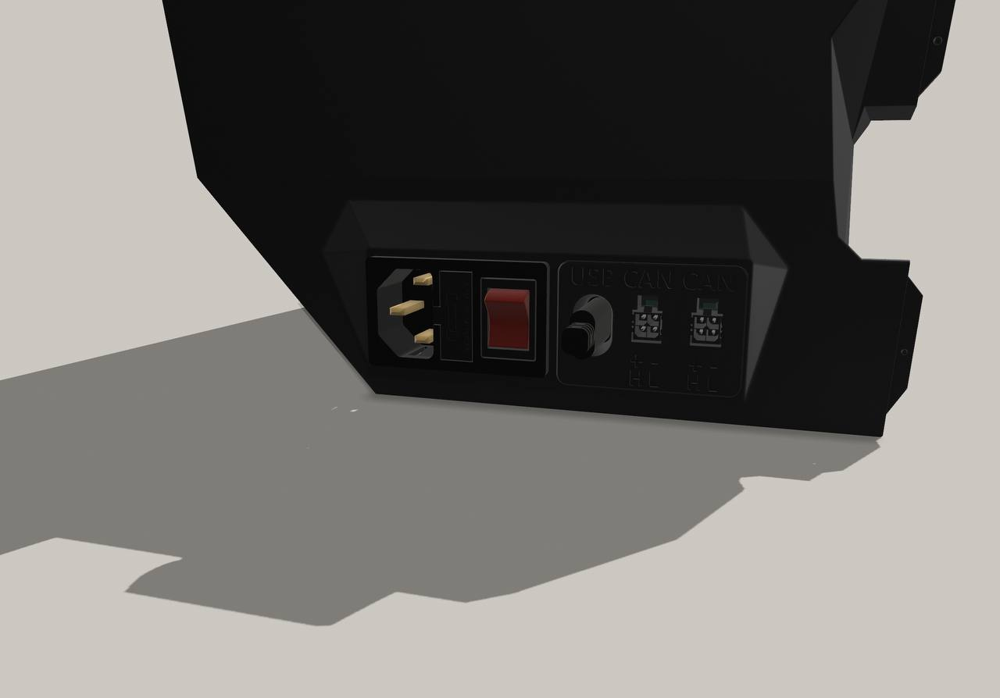

A custom PCB to simplify wiring of the CAN outlet.

The Chameleon X5 comes with an IO Board, but it is not used for the QuattroBox.

**Important**: The MicroFit 3.0 pinout of the PCB differs compared to the Chameleon X5 IO Board.
This is to match the pinout used by the EBB36 GEN2.

## BOM

- 1x XT30PW-M: [tme](https://www.tme.eu/de/details/xt30pw-m/dc-steckverbinder/amass/), [LCSC](https://www.lcsc.com/product-detail/C30170175.html)
- 2x MX-43045-0412: [tme](https://www.tme.eu/de/details/mx-43045-0412), [LCSC](https://www.lcsc.com/product-detail/C277721.html)
- 1x NUP2105L: [tme](https://www.tme.eu/de/details/nup2105l-dio), [LCSC](https://www.lcsc.com/product-detail/C14486.html)
- 1x SMBJ26A: [tme](https://www.tme.eu/de/details/p6smbj26a-dio), [LCSC](https://www.lcsc.com/product-detail/C726831.html)
- 1x Fuse in 1206 form factor: [tme](https://www.tme.eu/de/details/tr-3216ff4-r), [LCSC](https://www.lcsc.com/product-detail/C41367229.html)
- 1x JST XH 2 Pin connector: [tme](https://www.tme.eu/de/details/b2b-xh-a), [LCSC](https://www.lcsc.com/product-detail/C158012.html)

The board will function without the NUP2105L (protect CAN L/H against ESD) and SMBJ26A (protect against voltage ripples), the other parts are required.

For assembly:
- 3x M3x8mm screws
- 3x M3x4x5 heatset insert (the standard voron heatset inserts)

### Fuse

A fuse is supposed to cut an electrical connection when the current flowing through it exceeds a limit. After this happens, the fuse has to be replaced.
This is useful in case of for example a short-circuit where a large amount of current may flow, which can destroy components that are unable to handle
the current.

The Chameleon X5 IO Board uses a 20A fuse. The issue is that neither the MicroFit 3.0 nor the DC barrel jack are rated
to supply anywhere near 20A of power. Most MicroFit 3.0 connector are rated for 5A, there are some (like the one used in this board)
that are rated for 8.5A per pin. The DC barrel jack is rated for up to 3A.

If you want to have the fuse protect your hardware (e.g. it should blow before the connector melts), I would **not** install a 20A fuse.

As more current passes through a component, it will heat up. For the MicroFit 3.0 connector, the [Product Specification](https://www.molex.com/content/dam/molex/molex-dot-com/products/automated/en-us/productspecificationpdf/430/43045/PS-43045-001.pdf?inline)
shows on page 9 how much current could pass through the connector before it heats up by more than 30°C.
This depends on the cable diameter, how many wires are used, and the ambient temperature.

For the common use-case where the heaters are powered through AC, it is unlikely that the Chameleon X5 will pull
anywhere close to the 8.5A. I would recommend a fuse in the range of 4A to 8A.

Another use-case may be to install e.g. 70W @ 24V DC heaters, which are then powered and controlled through the Chameleon X5.
With each heater pulling ~2.9A, and the Chameleon X5 using some power too, I would suggest an 8A to 10A fuse. 

## Print settings

No special print settings are necessary. The parts are **not** shrinkage compensated.
For the spacer I would recommend a brim.

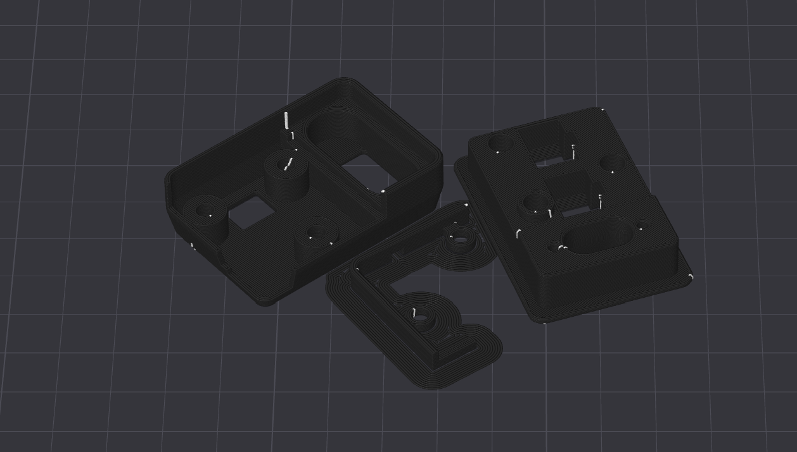

## PCB

The PCB has been designed in KiCAD10, the project files are located in [PCB](PCB).

The gerber files for ordering a PCB, can be found in [PCB/production/quattro-box-io-board.zip](PCB/production/quattro-box-io-board.zip).
It is a 2 layer board. I have ordered the parts myself, and assembled it by hand, therefore the `bom.csv` is incomplete or may contain
unavailable parts. No special consideration has been made to use jlc basic parts (the parts without extra costs),
therefore I recommend assembling it yourself.

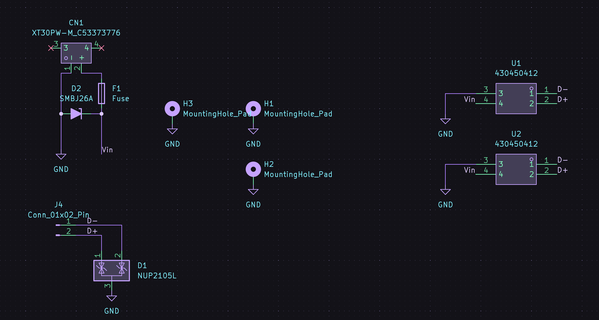
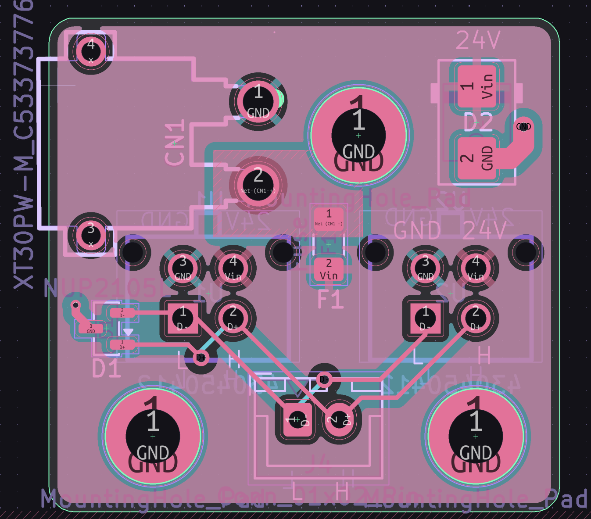

## Assembly

Three heatset inserts must be installed into this part. After you have done that, screw in the USB C connector (like in the original part with the M2 screws),
then seat it from the outside of the box:
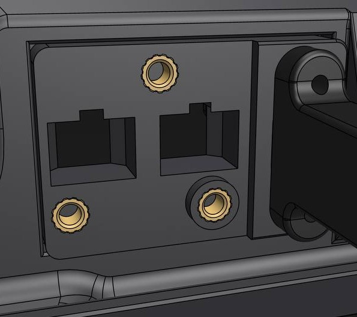

To avoid wobbling, there is a spacer that should now be installed:
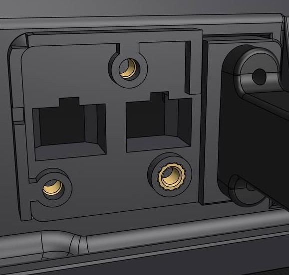

Then install the PCB:
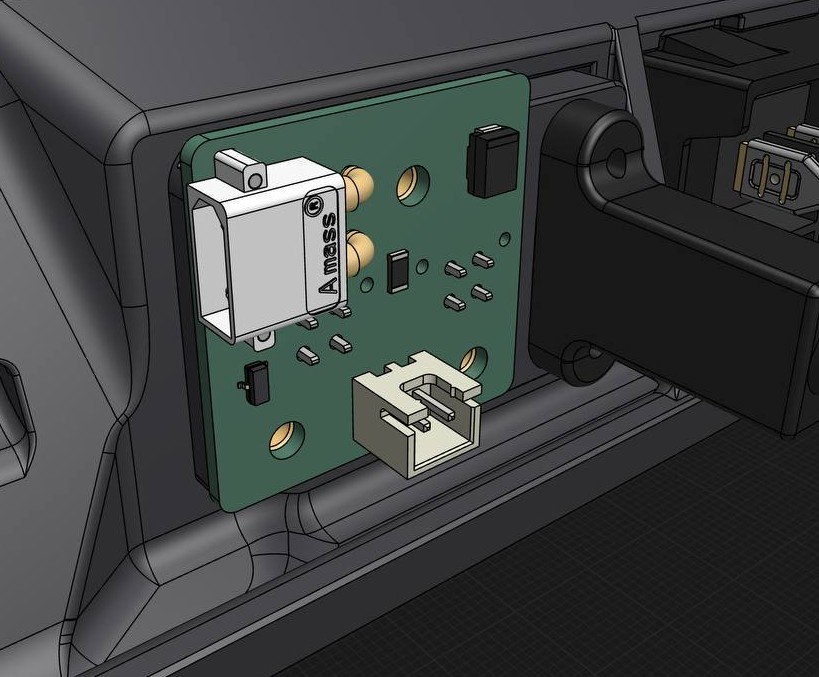

Add the PCB cover and add the 3 screws to hold everything together:
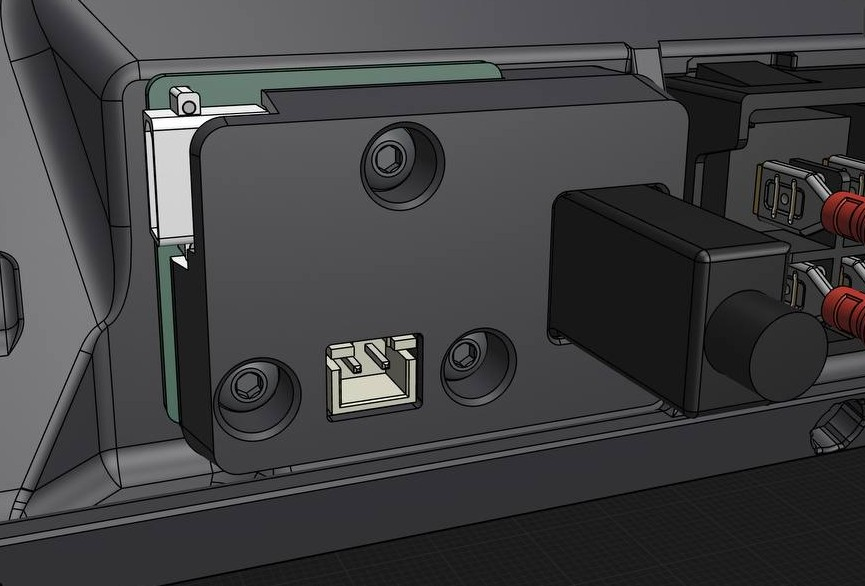

## More images

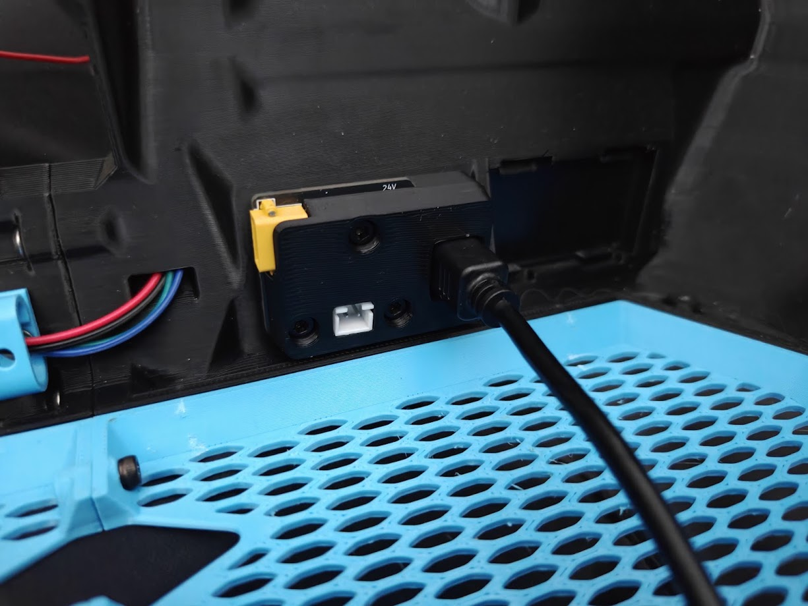
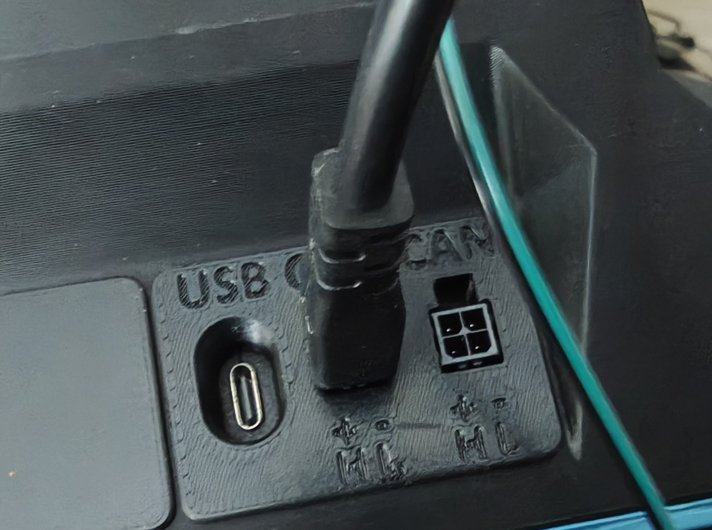

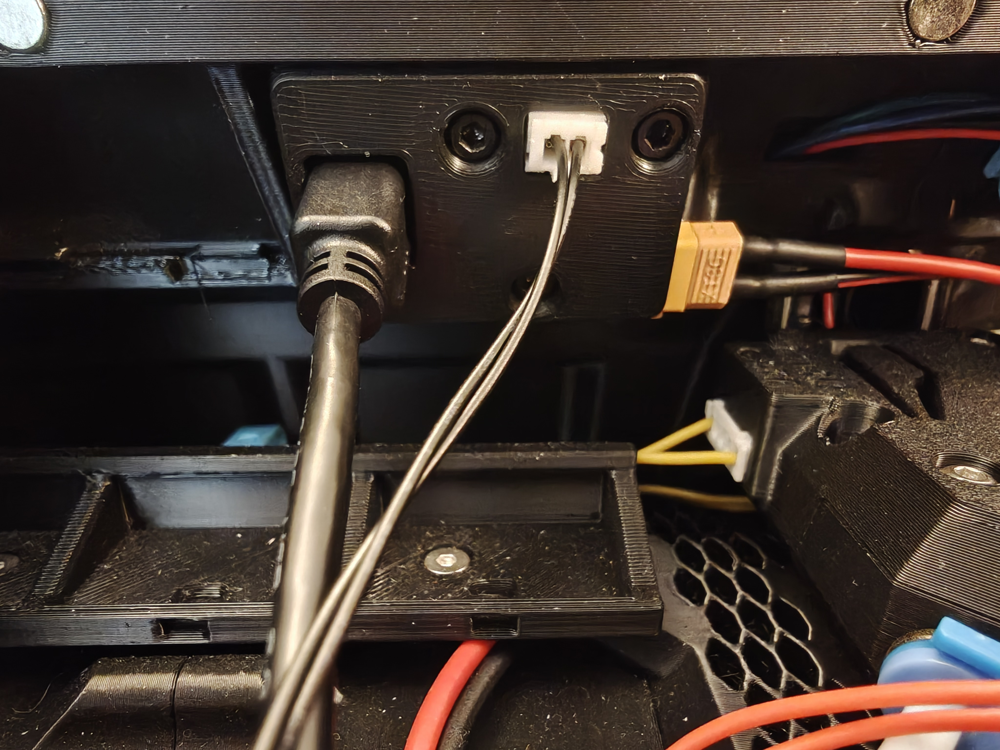
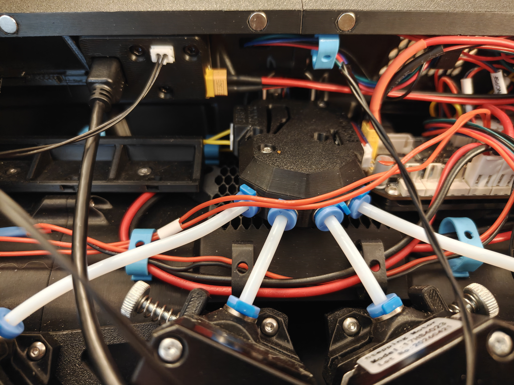

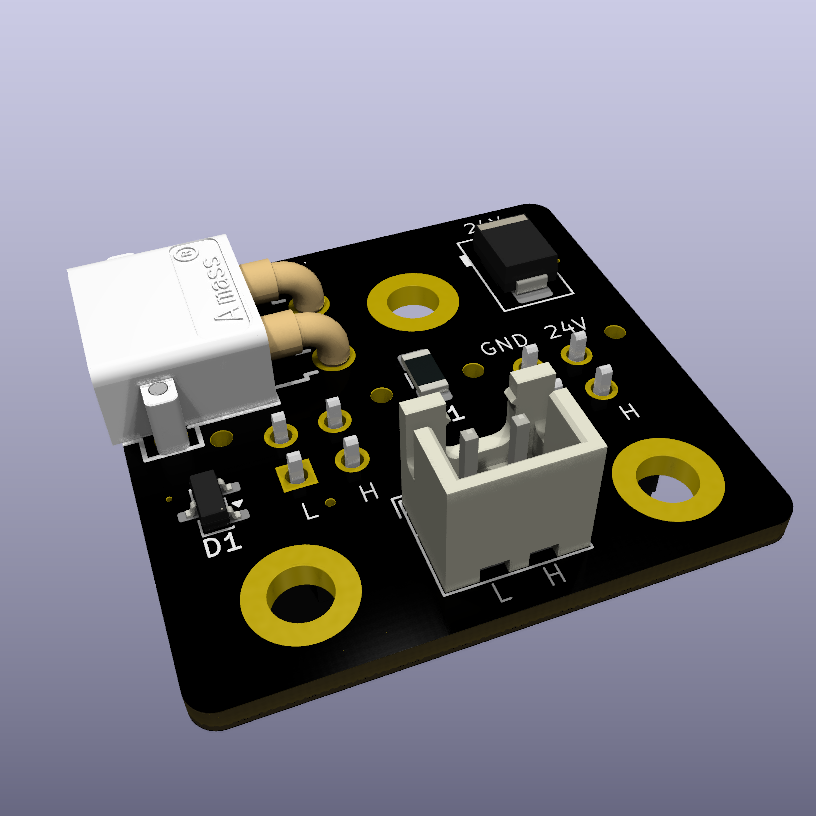
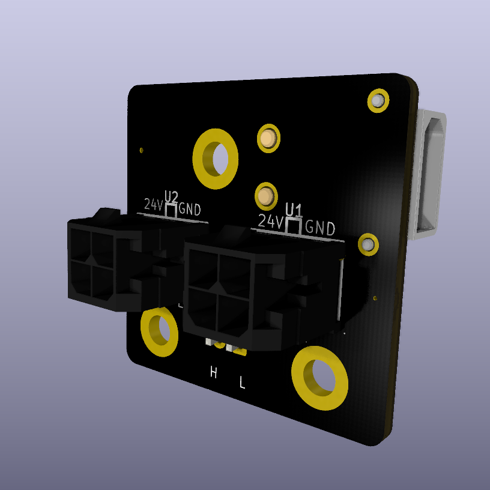

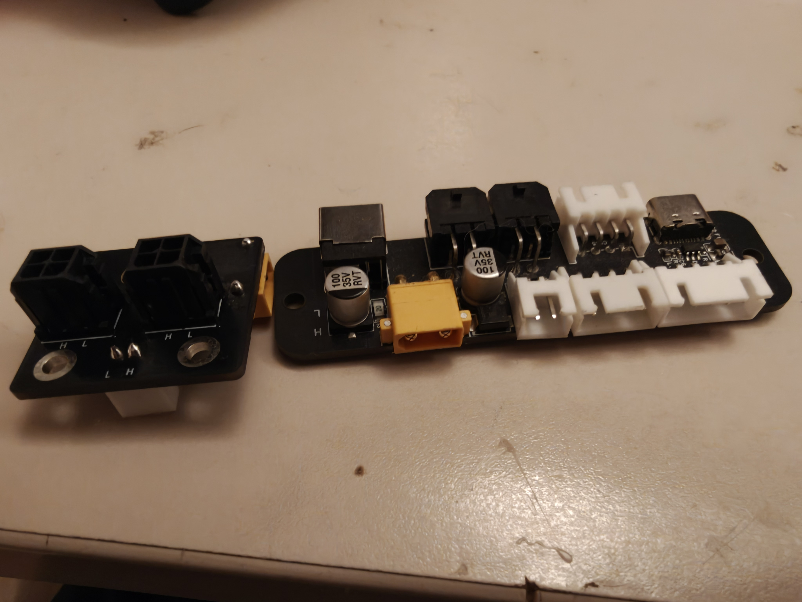
